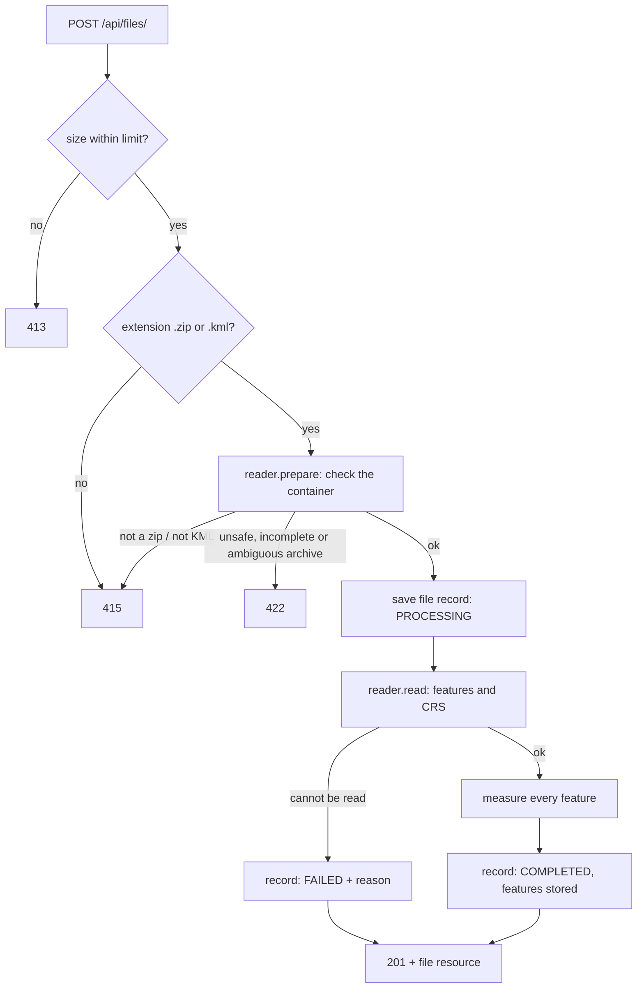
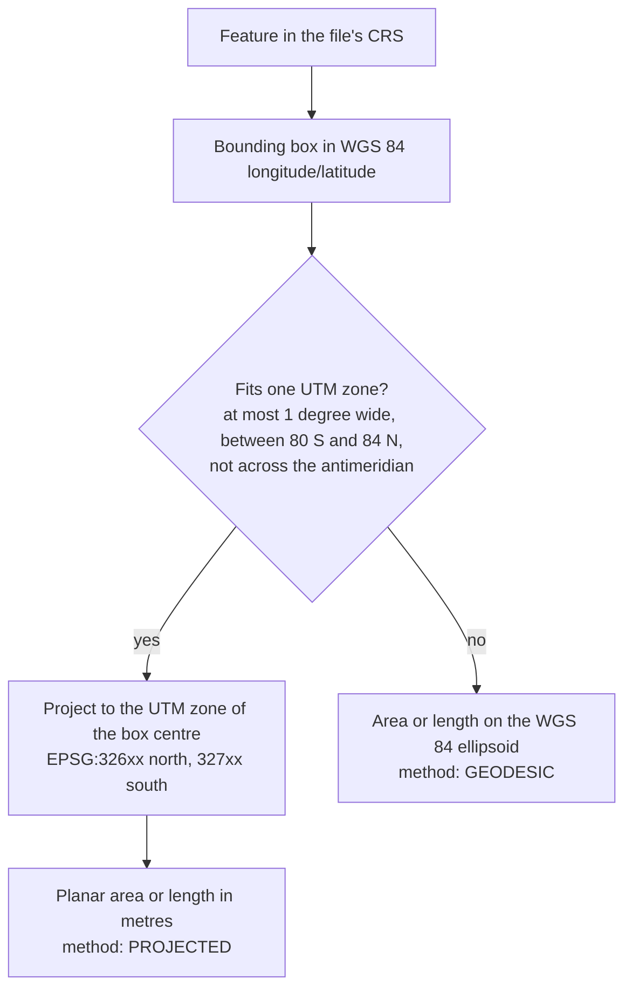

# Geospatial File Measurement API

A backend service that accepts a **KML** file or a **zipped Shapefile**, extracts every feature,
and returns the **area of polygons** and the **length of lines** in metres. Coordinates in degrees
are never measured directly: each feature is projected to the WGS 84 / UTM zone it lies in, and
the response names the EPSG code used so any number can be reproduced in a GIS.

Built with FastAPI, GeoPandas, Shapely and pyproj for the AEREO software development internship
assignment.

**Contents:** [Setup](#setup) · [API](#api) · [Architecture](#architecture) ·
[Design decisions](#design-decisions) · [Testing](#testing) · [Learnings](#learnings) ·
[Future scope](#future-scope)

## Setup

Requires Python 3.12 or newer. No system GDAL is needed: the Python wheels bundle GDAL, GEOS and PROJ.

### Run locally

```bash
python -m venv .venv
source .venv/bin/activate          # Windows PowerShell: .venv\Scripts\Activate.ps1
pip install -e ".[dev]"
uvicorn app.main:app --reload
```

The API is now at `http://127.0.0.1:8000`, with interactive documentation at
[`/docs`](http://127.0.0.1:8000/docs). Two sample files are in [`samples/`](samples/).

### Run with Docker

```bash
docker compose up --build
```

The image runs as a non-root user and keeps its database in a named volume.

### Configuration

Environment variables, or a `.env` file. All are optional.

| Variable | Default | Meaning |
| --- | --- | --- |
| `APP_DATABASE_URL` | `sqlite:///./data/measurements.db` | SQLAlchemy database URL |
| `APP_MAX_UPLOAD_BYTES` | `52428800` (50 MB) | Largest upload accepted |
| `APP_MAX_ARCHIVE_UNCOMPRESSED_BYTES` | `524288000` (500 MB) | Largest zip content, uncompressed (zip-bomb guard) |
| `APP_MAX_ARCHIVE_ENTRIES` | `1000` | Most entries allowed in a zip |
| `APP_LOG_LEVEL` | `INFO` | Log level |

### Developer commands

| Task | Command |
| --- | --- |
| Tests with coverage | `pytest --cov=app --cov-report=term-missing` |
| Lint and format check | `ruff check . && ruff format --check .` |
| Type-check | `mypy` |
| Install git hooks | `pre-commit install` (with the virtual environment active) |
| Rebuild the sample files | `python scripts/make_samples.py` |

`make check` runs lint, type-check and tests together where `make` is available. GitHub Actions
runs the same checks, then builds the Docker image and uploads a sample file to it.

## API

| Method and path | Purpose |
| --- | --- |
| `POST /api/files/` | Upload and process a file |
| `GET /api/files/{id}/` | Information about an uploaded file |
| `GET /api/files/{id}/measurements/` | Measurements for the features in the file |
| `GET /api/files/` | List uploaded files, newest first |
| `DELETE /api/files/{id}/` | Delete a file and its measurements |
| `GET /health` | Liveness check |

The first three are the brief's, with exactly its paths. List and delete are added so that a file
can be found again without its id, and removed. The same paths without the trailing slash also
work, with no redirect.

**Every response below was copied from the running service**, using the files in `samples/`. This
is the short tour: [docs/API.md](docs/API.md) has every endpoint with its full responses, and the
running service documents itself at [`/docs`](http://127.0.0.1:8000/docs). On Windows PowerShell,
use `curl.exe` instead of `curl`.

### Upload a file

`POST /api/files/` takes a multipart form with one field, `file`: a `.kml`, or a `.zip`
containing one shapefile (`.shp`, `.shx`, `.dbf`; `.prj` and `.cpg` if present).

```bash
curl -i -F "file=@samples/survey.kml" http://127.0.0.1:8000/api/files/
```

```http
HTTP/1.1 201 Created
content-type: application/json
location: /api/files/2be4806a-c825-4018-ae15-da3c95d9f5e7/
x-request-id: 57ba587ea1384637917adaa2e9f437bc
```

```json
{
  "id": "2be4806a-c825-4018-ae15-da3c95d9f5e7",
  "filename": "survey.kml",
  "format": "KML",
  "size_bytes": 2407,
  "status": "COMPLETED",
  "feature_count": 7,
  "crs": "EPSG:4326",
  "crs_assumed": false,
  "error": null,
  "created_at": "2026-10-08T15:51:51.612485Z",
  "processed_at": "2026-10-08T15:51:51.644990Z",
  "links": {
    "self": "/api/files/2be4806a-c825-4018-ae15-da3c95d9f5e7/",
    "measurements": "/api/files/2be4806a-c825-4018-ae15-da3c95d9f5e7/measurements/"
  }
}
```

The file is read and measured before the response is sent. **The HTTP status says whether the
upload was accepted; the `status` field says how processing ended** (`COMPLETED` or `FAILED`).

### Get file information

```bash
curl http://127.0.0.1:8000/api/files/2be4806a-c825-4018-ae15-da3c95d9f5e7/
```

Returns the same resource as the upload response. The five fields in the brief's example (`id`,
`filename`, `feature_count`, `crs`, `status`) are always present.

| Field | Meaning |
| --- | --- |
| `status` | `PROCESSING`, `COMPLETED` or `FAILED` |
| `feature_count` | Number of features; `null` until processing succeeds |
| `crs` | The file's CRS as `EPSG:<code>`; `null` if unknown |
| `crs_assumed` | `true` when a shapefile had no `.prj` and EPSG:4326 was assumed |
| `error` | Why processing failed, when `status` is `FAILED` |

### Get measurements

```bash
curl http://127.0.0.1:8000/api/files/2be4806a-c825-4018-ae15-da3c95d9f5e7/measurements/
```

One item per feature. Each carries the feature's index, id, geometry type, geometry, CRS and
properties, together with its measurement. The first of the seven items is shown in full:

```json
{
  "file_id": "2be4806a-c825-4018-ae15-da3c95d9f5e7",
  "crs": "EPSG:4326",
  "summary": {
    "total_area_m2": 187499.999,
    "total_length_m": 1700.0,
    "total_geodesic_area_m2": 187285.37,
    "total_geodesic_length_m": 1699.027,
    "measured": 4,
    "not_required": 2,
    "unsupported": 1,
    "failed": 0
  },
  "pagination": { "limit": 100, "offset": 0, "total": 7 },
  "links": {
    "self": "/api/files/2be4806a-c825-4018-ae15-da3c95d9f5e7/measurements/?limit=100&offset=0",
    "file": "/api/files/2be4806a-c825-4018-ae15-da3c95d9f5e7/",
    "next": null,
    "prev": null
  },
  "items": [
    {
      "feature_index": 0,
      "source_id": "field-a",
      "geometry_type": "Polygon",
      "geometry": {
        "type": "Polygon",
        "coordinates": [[
          [77.584602871, 12.967847203, 0.0],
          [77.584626199, 12.970105574, 0.0],
          [77.58094178, 12.970142157, 0.0],
          [77.580918484, 12.96788378, 0.0],
          [77.584602871, 12.967847203, 0.0]
        ]]
      },
      "crs": "EPSG:4326",
      "properties": { "Name": "Field A", "crop": "ragi", "owner": "Asha" },
      "measurement": {
        "type": "AREA",
        "value": 100000.0,
        "unit": "m2",
        "method": "PROJECTED",
        "projected_crs": "EPSG:32643",
        "geodesic_value": 99885.822,
        "status": "MEASURED",
        "reason": null,
        "geometry_repaired": false
      }
    },
    "(six more items: see the table below)"
  ]
}
```

All seven results for `survey.kml`:

| # | `source_id` | Geometry | `value` | `projected_crs` | `geodesic_value` | `status` |
| --- | --- | --- | --- | --- | --- | --- |
| 0 | `field-a` | Polygon | 100000.0 m2 | EPSG:32643 | 99885.822 m2 | MEASURED |
| 1 | `field-b` | Polygon with a hole | 87499.999 m2 | EPSG:32643 | 87399.548 m2 | MEASURED |
| 2 | `line-1` | LineString | 1000.0 m | EPSG:32643 | 999.427 m | MEASURED |
| 3 | `line-2` | LineString | 700.0 m | EPSG:32643 | 699.6 m | MEASURED |
| 4 | `gcp-1` | Point | none | | none | NOT_REQUIRED |
| 5 | `gcp-2` | Point | none | | none | NOT_REQUIRED |
| 6 | `note-1` | GeometryCollection | none | | none | UNSUPPORTED |

**Measurement fields**

| Field | Meaning |
| --- | --- |
| `type` | `AREA` (polygons), `LENGTH` (lines), or `null` |
| `value`, `unit` | The number, rounded to the millimetre, and `m2` or `m` |
| `method` | `PROJECTED` (measured in `projected_crs`) or `GEODESIC` (measured on the WGS 84 ellipsoid) |
| `projected_crs` | The UTM zone the feature was measured in |
| `geodesic_value` | The same measurement on the WGS 84 ellipsoid, in the same unit. This is the figure a GIS shows when it measures on the ellipsoid, as QGIS's `$area` does. Equal to `value` when `method` is `GEODESIC` |
| `status` | `MEASURED`, `NOT_REQUIRED` (points), `UNSUPPORTED`, or `FAILED` |
| `reason` | Why a feature was not measured |
| `geometry_repaired` | `true` when an invalid polygon was repaired before measuring |

**Query parameters**

| Parameter | Effect |
| --- | --- |
| `limit`, `offset` | Page through `items`: default 100, maximum 1000 |
| `geometry_type` | Only features of that type, for example `Polygon`. Repeat it to allow several |
| `status` | Only features whose measurement has that status. Repeat it to allow several |
| `include_geometry=false` | Leaves `geometry` out of every item: 2,793 bytes for this file, where the full response is 3,966 |

`summary` always covers the whole file; `pagination.total` counts the features the filters leave.
For this file, `?geometry_type=Polygon` returns the two fields and `?status=UNSUPPORTED` returns
`note-1`.

### List and delete files

```bash
curl "http://127.0.0.1:8000/api/files/?limit=20"
curl -i -X DELETE http://127.0.0.1:8000/api/files/3b0f3ec1-ee7c-40aa-8f69-20d110e7d54e/
```

`GET /api/files/` returns every upload, newest first, including uploads that `FAILED`. Each item
is the resource `GET /api/files/{id}/` returns, and `limit` and `offset` page through them.

`DELETE /api/files/{id}/` removes the file and every feature stored for it. It answers
`204 No Content`, and the id then answers 404. A file that is still `PROCESSING` cannot be deleted
(409): the request that uploaded it is still writing to it.

### Errors

Every error has one shape, RFC 9457 Problem Details, sent as `application/problem+json`.

```bash
curl -i -F "file=@parcels.zip" http://127.0.0.1:8000/api/files/    # an archive with no .dbf
```

```http
HTTP/1.1 422 Unprocessable Entity
content-type: application/problem+json
```

```json
{
  "type": "about:blank",
  "title": "Unprocessable Content",
  "status": 422,
  "detail": "The archive is missing parcels.dbf, which a shapefile requires.",
  "instance": "/api/files/"
}
```

| Status | When | Example `detail` |
| --- | --- | --- |
| 400 | Malformed request: no `file` field, `limit` or `offset` out of range, an unknown `geometry_type` or `status` | `The request is not valid.` plus an `errors` list naming `query.limit` |
| 404 | Unknown file id or path | `No uploaded file has this id.` |
| 405 | A method the path does not accept | `Method Not Allowed`, with an `Allow` header naming every method it does accept, for example `DELETE, GET` |
| 409 | Measurements requested for a file that is not `COMPLETED`, or a delete while it is `PROCESSING` | `The file could not be processed, so it has no measurements. ...` |
| 413 | Upload larger than the limit | `The upload is larger than the limit of 52428800 bytes.` |
| 415 | Not a `.zip` or `.kml`, or the content is not what the extension claims | `Only .kml files and .zip archives containing a shapefile are accepted.` |
| 422 | A real zip or KML that cannot be accepted | `The archive is missing parcels.dbf, which a shapefile requires.` |
| 500 | Unexpected failure | `An unexpected error occurred.` (the traceback goes to the log, with the request id) |

**An accepted file that cannot be read** is not a 4xx. The upload returns 201 with
`"status": "FAILED"` and the reason in `error`, so the record explains what happened.

Every response carries an `X-Request-ID` header. Send your own and it is kept; the same id is
written on every log line for that request.

## Architecture

### Application structure

```
app/
  main.py            create_app(): settings, database, middleware, error handlers, routes
  domain.py          the shared vocabulary: enums and the value objects passed between layers
  api/               HTTP only: routes, dependencies, middleware, error rendering, JSON mapping
  schemas/           Pydantic response models (the public JSON shapes)
  services/          FileService, the one entry point the API calls
  readers/           one reader per file format behind a common interface, plus a registry
  geometry/          CRS selection and measurement (Shapely and pyproj only)
  repositories/      all SQL
  models/            SQLAlchemy tables
  core/              settings, error types, logging
tests/               unit tests per module; API tests through HTTP on a temporary database
samples/, scripts/   sample files of known size, and the script that builds them
docs/                API.md, DECISIONS.md, REQUIREMENTS.md, ENGINEERING_PRINCIPLES.md
```

Dependencies point one way: `api → services → readers / geometry / repositories`. Routes never
import GeoPandas or SQLAlchemy. Only `readers` import GeoPandas. Only `repositories` run queries.

### File-processing flow



1. **Size limit.** A middleware rejects a body over the limit, counting the bytes that arrive.
2. **Format.** The extension picks a reader from a registry: `.kml` or `.zip`.
3. **Container check** (`prepare`). KML: the root element must be `kml`, and a `DOCTYPE` is
   refused. Zip: no absolute or `..` paths, not encrypted, within the size caps, and exactly one
   shapefile with its `.shx` and `.dbf`. Files are saved under fixed names, so no name from the
   client or the archive is ever a path.
4. **Record.** The file is stored as `PROCESSING`.
5. **Read** (`read`). GDAL parses the file; the reader returns plain feature objects and the CRS.
6. **Measure** every feature, then store them and mark the file `COMPLETED` in one transaction.

A rejected upload (steps 1 to 3) stores nothing and answers 4xx. Once a file is accepted it always
has a record, and `status` says how processing ended.

### Measurement calculation flow

For each feature:

| Geometry | Result |
| --- | --- |
| Polygon, MultiPolygon | Area in m2: holes excluded, parts summed |
| LineString, MultiLineString | Length in m: parts summed |
| Point, MultiPoint | `NOT_REQUIRED` |
| GeometryCollection, missing or undecodable geometry | `UNSUPPORTED`, with a reason |

Before measuring, Z values are dropped (measurements are planimetric) and an invalid polygon is
repaired with `shapely.make_valid` and flagged. Each feature is measured inside its own error
boundary: one bad feature becomes `FAILED` with a reason and the rest of the file is unaffected.

Every measured feature carries two numbers: `value`, measured in its UTM zone, and
`geodesic_value`, the same area or length on the WGS 84 ellipsoid.

### CRS handling



- **The rule.** Every feature is measured in the WGS 84 / UTM zone containing the centre of its
  bounding box. The zone is `floor((longitude + 180) / 6) + 1`.
- **It applies to every source CRS,** projected ones included, because "projected" does not mean
  "fit for measuring": a parcel in Delhi comes out **30.2% too large** when its area is taken
  directly in Web Mercator (EPSG:3857). A file already in its UTM zone is measured as it is.
- **When no UTM zone fits,** the feature is measured on the ellipsoid and reports
  `method: GEODESIC`. This is the one place the service departs from the letter of the brief
  ("transform to a projected CRS"): for a feature spanning several zones no single appropriate
  projected CRS exists.
- **Grid and ground.** A UTM value is a grid value: it differs from the size on the ellipsoid by
  UTM's scale factor, up to about 0.2% in area. A GIS that measures on the ellipsoid shows the
  other figure, so `geodesic_value` reports it next to `value`: 100,000.0 m2 and 99,885.822 m2
  for Field A.
- **Where the CRS comes from.** KML is EPSG:4326 by its standard; a shapefile's comes from its
  `.prj`. Without one, EPSG:4326 is assumed only if every coordinate could be a degree, the file
  is flagged `crs_assumed`, and only features under 1° wide are measured: a 50 m × 40 m plot drawn
  in metres also passes that range check, and read as degrees it measured 21 million km².
- **Axis order.** Geometries are x = longitude, y = latitude; every transformer is created with
  `always_xy=True`.

## Design decisions

The full record, with measurements behind each number, is in [docs/DECISIONS.md](docs/DECISIONS.md).
The principles applied are in [docs/ENGINEERING_PRINCIPLES.md](docs/ENGINEERING_PRINCIPLES.md).

| Decision | Chosen | Alternatives considered, and why they lost |
| --- | --- | --- |
| Framework | FastAPI | Django + DRF: an ORM, admin and migrations that a handful of endpoints do not use. |
| Reading files | GeoPandas with pyogrio | Fiona (a second GDAL binding, no benefit); a hand-written KML parser (re-implements GDAL); GeoDjango (needs a system GDAL). pyogrio's wheel includes the LIBKML driver, which reads `ExtendedData`; the older KML driver drops it. |
| Projected CRS | The feature's own UTM zone | **Web Mercator:** +30% area at Delhi. **One global equal-area CRS (EPSG:6933):** exact areas, but lengths measured −11% east-west and +12% north-south at Bengaluru. **One zone per file:** same result for one site, worse across zones. **A custom projection centred on each feature:** the most accurate, but not reproducible by picking an EPSG code. **Geodesic for everything:** most accurate, but the brief asks for projection. |
| Projected source files | Reprojected to UTM like any other | Trusting any projected CRS: wrong for Web Mercator and other display projections. |
| Grid and ground values | Both: `value` in UTM, `geodesic_value` on the ellipsoid | **UTM only:** differs from an ellipsoidal measurement by up to 0.2% with nothing to explain why. **Ellipsoid only:** the brief asks for projection. **A projection centred on each feature:** one value that matches the ellipsoid, but a parcel drawn as 100 m × 100 m in a UTM file measured 9,988.6 m2, and its CRS has no EPSG code. |
| Processing | Inside the request | A background worker with 202 Accepted: right for very large files, but adds a broker and a second process. The resource already exposes `status`, so the move would not change its shape. |
| Unreadable content | 201 with `status: FAILED` | 422 and store nothing: simpler, but `status` could then only ever be `COMPLETED`. |
| Statuses | `PROCESSING`, `COMPLETED`, `FAILED` | `PENDING`: it means "queued"; nothing is queued, so it would be unreachable. |
| Storage | SQLite through SQLAlchemy; raw upload not kept | PostgreSQL / PostGIS: needed for several workers or spatial queries, neither of which exists yet. |
| Patterns | Facade (the service), Strategy as a registry (readers), value objects | Factory Method, Template Method, Singleton: class hierarchies or global state for what a dictionary and dependency injection already do. |
| GeometryCollection | `UNSUPPORTED`, not decomposed | Summing a polygon's area and a line's length: not a quantity. |
| Missing `.prj` | Assume EPSG:4326 only if coordinates could be degrees, flag it, and measure only features under 1° wide | Refuse to measure: prj-less WGS 84 shapefiles are common. Guess silently: never. Trust the guess at any size: a plot drawn in metres came back larger than Russia. |
| Error format | RFC 9457 Problem Details | FastAPI's default `{"detail": ...}`: a second, different shape for validation errors. |
| Units | `m2`, `m` (UCUM codes) | `m²`: unreadable in consoles that are not UTF-8. |

## Testing

```bash
pytest --cov=app --cov-report=term-missing
```

257 tests, 99% coverage. Lint (ruff) and strict type-checking (mypy) are clean. GitHub Actions
runs all of it, and builds and starts the Docker image, on every pull request and every push to
`main`. A shapefile of 20,000 polygons is uploaded, measured both ways and stored in about
2 seconds on a laptop.

**The accuracy tests use shapes whose size is known.** A shape is drawn in metres in a UTM zone,
converted to the CRS under test, written to a real KML or zipped shapefile and uploaded through
HTTP, and the API's answer is compared with the size it was drawn at. That covers the whole chain:
parsing, axis order, zone selection, projection and units. Ellipsoid results are checked against
figures that do not come from pyproj.

**The sample file, grid against ground.** "Drawn" is the size each shape was built at, in UTM 43N.

| Feature | Drawn | API `value` | API `geodesic_value` | Difference |
| --- | --- | --- | --- | --- |
| Field A | 100,000 m2 | 100,000.000 m2 | 99,885.822 m2 | +0.114% |
| Field B (with a pond cut out) | 87,500 m2 | 87,499.999 m2 | 87,399.548 m2 | +0.115% |
| Line 1 | 1,000 m | 1,000.000 m | 999.427 m | +0.057% |
| Line 2 | 700 m | 700.000 m | 699.600 m | +0.057% |

`value` reproduces the drawn sizes to the millimetre. Its difference from `geodesic_value` is UTM's
own scale factor, the grid-to-ground difference surveyors know: at this site, 2.6° east of the
zone's central meridian, PROJ reports a point scale factor of 1.000571 (1.001143 for area), which
is exactly the 0.057% and 0.114% in the table.

To reproduce a `value` in a GIS, reproject the layer to the `projected_crs` the API reports and
measure it there; a measurement on the ellipsoid corresponds to `geodesic_value`. (QGIS was not
part of this build; the figures above are the API's.)

**Also covered:** files already in UTM, in Web Mercator, in US survey feet, and on another datum;
a missing `.prj`, a plot drawn in metres with no `.prj`, and an unknown CRS; features wider than a
zone, polar, and across the antimeridian; polygons with holes, multi-part and 3D geometries,
self-crossing polygons; zip-slip paths, oversized, encrypted and corrupt archives, macOS archive
debris; KML with a `DOCTYPE`; paging and filter bounds; every error status.

**Checked against real files.** The tests build their own files, so on 2026-10-10 four public
datasets were uploaded as well. They are not kept in this repository.

| File | Result |
| --- | --- |
| US Census TIGER/Line 2023 tracts, Washington DC: 206 polygons in NAD83, each carrying its official land and water area | Every tract measured. `geodesic_value` is within 0.0013% of the official area for every tract, and `value` within 0.012% |
| Natural Earth 1:110m countries: 177 features | Every feature measured, Antarctica and the countries split at the antimeridian included. They total 147.4 million km2; the Earth's land area is about 149 million |
| Natural Earth 1:110m rivers: 13 lines | Every line measured |
| Google's KML sample file: 21 features with styles, HTML descriptions, altitude modes and overlays | Every feature read and no errors. The placemark without a geometry is `UNSUPPORTED`. A `GroundOverlay` comes through as the polygon of its bounding box |

## Learnings

What building this made concrete:

- **A projected CRS is not automatically a measuring CRS.** Web Mercator is projected and in
  metres, and inflated a Delhi parcel by 30%. The first design measured projected files directly;
  testing that assumption changed the rule to "always measure in the feature's UTM zone".
- **UTM itself is not exact, and the size of the error is knowable.** A grid value and the size on
  the ellipsoid differ by the scale factor: 0.114% for the sample. Reporting both numbers explains
  a difference that would otherwise look like a bug next to an ellipsoidal measurement.
- **Numbers that fit the range of degrees are not always degrees.** A 50 m × 40 m plot drawn in
  metres, with no `.prj`, passed the range check and was measured as larger than Russia. A guess
  about what coordinates mean needs a second check on whether the result is plausible.
- **Check the library by running it.** Three things only showed up by running the installed
  versions: pyproj's geodesic polygon area adds a hole when its ring is wound the same way as the
  outer ring; one KML Placemark holding a bare `LinearRing` aborts GDAL's read of the whole layer;
  and GDAL's error text contains the server's temporary path.
- **Rejecting an upload and failing to process it are different outcomes.** Separating "check the
  container" from "read the content" gave a clear rule for 4xx versus `status: FAILED`.
- **Never using a client-supplied name as a path** removes a whole class of problems (zip-slip,
  reserved Windows names) more reliably than validating the names does.

## Future scope

In rough order of value to a drone-survey workflow:

1. **Background processing** (202 Accepted and a worker queue) for large survey files, with retries.
2. **A client-supplied CRS** at upload for files without a `.prj`, instead of an assumption.
3. **A projection centred on each feature** (for example Lambert azimuthal equal-area) as an
   alternative to UTM. The projected value itself would then match the ellipsoid, at the cost of a
   one-off PROJ definition in place of an EPSG code. Reporting the scale factor next to the two
   values belongs with it.
4. **More measurements:** polygon perimeter, unit conversion (hectares, acres, kilometres), and 3D
   length and surface area using the Z values.
5. **More inputs:** KMZ, GeoJSON, GeoPackage, and archives holding several shapefiles.
6. **GeoJSON export** of a file's features with their measurements, and filtering by KML folder
   and bounding box.
7. **Sorting and filtering the file list** (by status, format, name or date).
8. **PostgreSQL / PostGIS** with Alembic migrations, for several workers and spatial queries.
9. **Authentication, rate limiting and ETags.**
10. **A map preview page** showing features coloured by measurement status.
