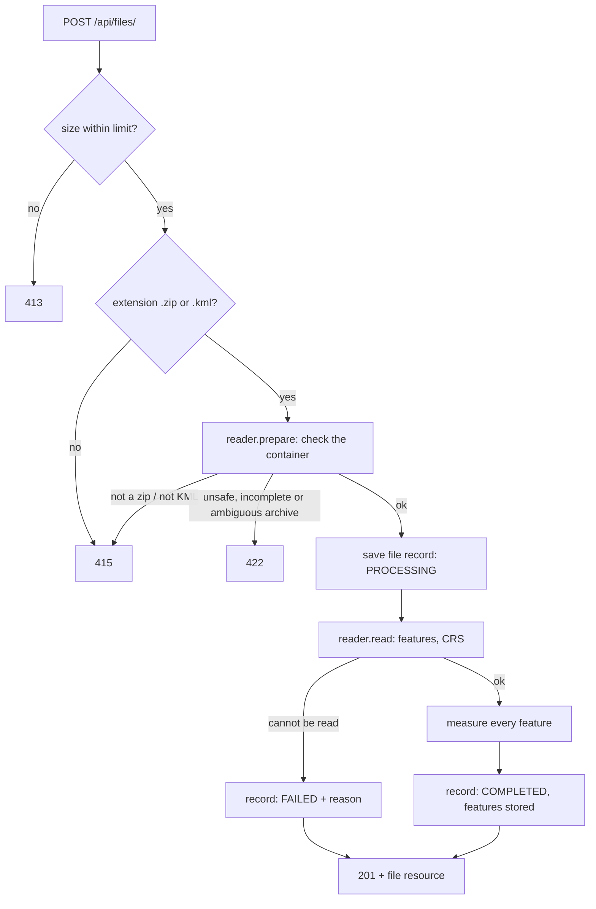

# Design decisions

Status: **implemented.** Each decision gives the choice, the reason, and the
alternatives that lost. Numbers quoted as "measured" were produced on this project's own library
versions (GDAL 3.12, PROJ 9.8, GEOS 3.14, GeoPandas 1.2, pyogrio 0.13, Shapely 2.2, pyproj 3.8).

Contents: [Architecture](#architecture) · [D1 Framework](#d1-framework) ·
[D2 Geospatial stack](#d2-geospatial-stack) · [D3 Layers and patterns](#d3-layers-and-patterns) ·
[D4 Processing model](#d4-processing-model-and-status) · [D5 Data model](#d5-persistence-and-data-model) ·
[D6 Upload validation](#d6-upload-validation) · [D7 Reading files](#d7-reading-files-into-features) ·
[D8 CRS strategy](#d8-crs-strategy) · [D9 Measurement rules](#d9-measurement-rules) ·
[D10 API contract](#d10-api-contract) · [D11 Errors](#d11-errors) ·
[D12 Configuration and tooling](#d12-configuration-logging-and-tooling) · [D13 Testing](#d13-testing) ·
[Not built](#not-built)

## Architecture

```
app/
  main.py            create_app(): routers, middleware, error handlers, startup
  domain.py          the shared vocabulary: enums and the value objects passed between layers
  api/               HTTP only: routes, dependencies, middleware, error rendering, JSON mapping
  schemas/           Pydantic response models (the public JSON shapes)
  services/          FileService: the one entry point the API calls
  readers/           one reader per file format behind a common interface, plus a registry
  geometry/          CRS selection and measurement (Shapely + pyproj only)
  repositories/      all SQL
  models/            SQLAlchemy tables
  core/              settings, error types, logging
tests/               unit tests per module, API tests through the HTTP interface
docs/                REQUIREMENTS.md, DECISIONS.md, ENGINEERING_PRINCIPLES.md
```

Dependencies point one way: `api → services → readers / geometry / repositories`. Routers never
import GeoPandas or SQLAlchemy. Only `readers` import GeoPandas. Only `repositories` run queries.

### File-processing flow



### Measurement flow, per feature

1. No geometry, or a type with no single measurement: `UNSUPPORTED` with a reason.
2. Point or MultiPoint: `NOT_REQUIRED`.
3. Unknown CRS: `UNSUPPORTED`, reason `unknown CRS`.
4. Drop Z, repair an invalid polygon.
5. Find the feature's extent in longitude/latitude and pick the measuring method ([D8](#d8-crs-strategy)).
6. Project and measure, or measure on the ellipsoid. Any error becomes `FAILED` for that feature only.

## D1 Framework

**FastAPI.** The service is one resource with three endpoints. FastAPI gives typed request
validation, response models, and an OpenAPI page at `/docs` generated from the code, which doubles
as the reviewer's test console.

Alternative: Django + DRF. It brings an ORM, admin and migrations, all useful in a larger product
and unused here. More framework to explain for the same three endpoints.

## D2 Geospatial stack

**GeoPandas with the pyogrio engine to read files; Shapely 2 for geometry; pyproj for CRS work.**

- The pyogrio wheel bundles GDAL, so `pip install` is the whole setup on Windows, macOS and Linux.
  No system GDAL.
- Measured: the wheel includes the `LIBKML` driver, which reads Placemark ids, names and
  `ExtendedData` (both `<SchemaData>` and untyped `<Data>`). The older `KML` driver drops
  `ExtendedData`, which would lose the survey attributes.
- GeoPandas is used only to read. Measurement works on one Shapely geometry at a time, so that one
  bad feature can be isolated. Measured cost: 20,000 polygons projected and measured in 0.18 s.

Alternatives: Fiona (a second GDAL binding with no benefit over pyogrio); a hand-written KML parser
(full control, but re-implements what GDAL already handles); GeoDjango (needs a system GDAL install).

## D3 Layers and patterns

See [ENGINEERING_PRINCIPLES.md](ENGINEERING_PRINCIPLES.md) for the reasoning behind each verdict.

- **Facade:** `FileService` is the only object the routes call: `upload`, `get`, `measurements`.
- **Strategy by registry:** `READERS = {KML: KmlReader(), SHAPEFILE: ShapefileReader()}`. Each reader
  has two steps, `prepare` (check the container, return the path to open) and `read` (return a
  `GeoDataset`). The geometry type to measurement type mapping is a second lookup table.
- **Adapter at one boundary:** readers return our own `GeoDataset` and `SourceFeature` objects. No
  GeoDataFrame leaves the `readers` package.
- **Value objects:** `Measurement` carries value, unit, method, CRS, status and reason together.
- **Dependency injection instead of globals:** `create_app(settings)` builds the database engine;
  routes receive a session and a service through FastAPI dependencies. Tests build an app on a
  temporary database with no patching.

Rejected: Factory Method and Template Method (class hierarchies for what a dictionary and a
two-step interface already do), Singleton (hidden global state).

## D4 Processing model and status

**Processing runs inside the `POST` request.** The brief says the endpoint "uploads and processes a
file". The route is a plain `def`, so FastAPI runs it in a worker thread and the event loop stays
free during the CPU and disk work.

**Statuses: `PROCESSING`, `COMPLETED`, `FAILED`.** The record is saved as `PROCESSING` before
reading starts and updated when it ends.

**The HTTP status describes the upload; the `status` field describes the processing.**

| Situation | Response |
| --- | --- |
| Upload rejected (wrong type, too large, unsafe or incomplete archive) | 4xx Problem Details, nothing stored |
| Upload accepted, content read and measured | 201, `status: COMPLETED` |
| Upload accepted, content could not be read (for example a corrupt `.shp`) | 201, `status: FAILED`, `error` says why |
| Upload accepted, then an unexpected error (a bug or an outage) | 500 with no internal detail; the record is marked `FAILED` |

A client that always checks `status` keeps working unchanged if processing later moves to a
background worker (202 Accepted, then poll the same resource).

Alternatives:
- A background worker now (Celery, RQ, arq): the right design for large surveys, but it adds a
  broker and a second process to a three-endpoint service. Listed first in future scope.
- Return 422 for an unreadable file and store nothing: simpler, but `status` would then only ever
  be `COMPLETED`, and the contract would have to change when processing becomes asynchronous.
- A `PENDING` status: it means "queued, not started". Nothing is ever queued here, so the state
  would be unreachable. It arrives together with the queue.

Known limit: if the process is killed mid-upload, the record stays `PROCESSING`. A queue with
retries is the real fix.

## D5 Persistence and data model

**SQLAlchemy 2 with SQLite; tables created at startup.** A single file database needs no setup and
is enough for one process. The raw upload is **not** kept: everything the API returns is in the
database, and not keeping client files at rest is the safer default.

`uploaded_files`

| Column | Notes |
| --- | --- |
| `id` | UUID string, primary key |
| `filename` | client's name, sanitised; never used as a path |
| `format` | `KML` or `SHAPEFILE` |
| `size_bytes` | size of the upload |
| `status` | `PROCESSING`, `COMPLETED`, `FAILED` |
| `crs` | source CRS as `EPSG:<code>` when identifiable, else its definition; null if unknown |
| `crs_assumed` | true when the file declared no CRS and EPSG:4326 was assumed ([D7](#d7-reading-files-into-features)) |
| `feature_count` | null until processing succeeds |
| `error` | reason for `FAILED` |
| `created_at`, `processed_at` | UTC |

`features`

| Column | Notes |
| --- | --- |
| `id` | integer primary key |
| `file_id` | foreign key, indexed; unique together with `feature_index` |
| `feature_index` | 0-based position across the whole file |
| `source_id` | the file's own identifier, if any |
| `geometry_type` | for example `Polygon`; null when there is no geometry |
| `geometry` | GeoJSON geometry object, coordinates in the source CRS |
| `properties` | JSON object |
| `measurement_type` | `AREA`, `LENGTH` or null |
| `measurement_value`, `measurement_unit` | number and `m2` or `m`; null when not measured |
| `measurement_method` | `PROJECTED` or `GEODESIC` |
| `projected_crs` | for example `EPSG:32643`; null for `GEODESIC` |
| `measurement_status` | `MEASURED`, `NOT_REQUIRED`, `UNSUPPORTED`, `FAILED` |
| `measurement_reason` | why it was not measured |
| `geometry_repaired` | true when an invalid polygon was repaired before measuring |

The per-feature CRS in API responses is the file's CRS; it is stored once, on the file.

Alternatives: PostgreSQL (needed for several workers), PostGIS (spatial queries and indexes; nothing
here queries by location yet), Alembic migrations (needed once the schema changes in production).
All are future scope.

## D6 Upload validation

- **Type is checked twice:** by extension (`.zip`, `.kml`), then by content. A `.zip` must be a real
  zip archive. A `.kml` must be XML whose root element is `kml`. Otherwise 415.
- **Size:** a configurable limit on the request body (default 50 MB). The declared `Content-Length`
  is rejected early, and the bytes actually received are counted, so a chunked upload cannot bypass
  it. 413.
- **Zip safety** (422 on any failure):
  - an entry with an absolute path or a `..` segment (zip-slip);
  - too many entries, or a declared total size over the cap (zip bomb). A header that understates an
    entry's size cannot get past the cap: Python's `zipfile` never yields more than the declared
    size and then fails the CRC check, which is reported as a corrupt archive;
  - encrypted entries.
- **Shapefile completeness:** exactly one `.shp`, with its `.shx` and `.dbf` (the three files the
  Shapefile specification requires). Matching is case-insensitive and the files may sit in a
  subfolder. macOS archive debris (`__MACOSX/`, `._name.shp`) is ignored so it is not mistaken for a
  second shapefile. A missing part is named in the error. Several shapefiles in one archive are
  rejected; multi-layer archives are future scope.
- **Names from the client are never paths.** The upload and the extracted parts are written under
  fixed names (`upload.kml`, `shapefile.shp`, ...) inside a private temporary directory that is always
  removed. This makes zip-slip impossible by construction, in addition to the explicit check.
- **XML attacks:** a KML containing a `DOCTYPE` is rejected. KML does not need one, and without a
  DTD there are no entities to expand (billion laughs) or resolve (XXE).
- Measured: reading a KML with a `NetworkLink` and a remote `styleUrl` opened no network connection.

## D7 Reading files into features

**Feature identity.** `feature_index` is 0-based across the whole file, in the order GDAL returns
layers and features. `source_id` is the file's own id: the Placemark `id` attribute for KML (null
when absent), the record number (FID) for a shapefile.

**KML**
- CRS is EPSG:4326: the KML standard fixes coordinates as WGS 84 longitude, latitude.
- Every Folder and Document is a layer; all layers are read.
- Properties are the Placemark's name, description, time fields and `ExtendedData`. Fields that are
  null for a Placemark are omitted, because KML attributes are per-Placemark. The driver's rendering
  hints (`visibility`, `tessellate`, `extrude`, `altitudeMode`, `drawOrder`, `icon`) are left out:
  they describe how Google Earth draws the feature, not the feature.

**Shapefile**
- CRS comes from the `.prj`.
- No `.prj`: if every coordinate lies within longitude ±180 and latitude ±90, EPSG:4326 is assumed
  and the file is flagged `crs_assumed: true`. Otherwise `crs` is null and area/length are
  `UNSUPPORTED` with reason `unknown CRS`. The service never guesses silently.
- Properties are the DBF row, nulls kept (a shapefile has a fixed schema).

**Both**
- Property values are made JSON-safe: NaN and missing become null, dates become ISO 8601 strings,
  NumPy numbers become plain numbers, bytes become text.
- A geometry GDAL returns but GEOS cannot decode becomes a feature without geometry instead of an
  error. Measured: a Placemark holding a bare `<LinearRing>` otherwise aborts the whole layer.
- Zero features is a valid file: `COMPLETED`, `feature_count: 0`.
- GDAL error text contains the server's temporary path. The directory is stripped before the
  message is stored or returned; what remains is the fixed name the upload was saved under.

Alternative for a missing `.prj`: refuse to measure at all. Rejected because prj-less WGS 84
shapefiles are common and the assumption is visible in the response. Letting the client state the
CRS at upload is future scope.

## D8 CRS strategy

The brief: do not calculate area or distance in degrees; transform to an appropriate projected CRS;
the selection strategy is ours.

### The rule

Every feature is measured in the **WGS 84 / UTM zone that contains the centre of its bounding box**
(EPSG:326xx north, 327xx south). The zone number is `floor((longitude + 180) / 6) + 1`.

The same rule applies whatever the source CRS is:

| Source CRS | What happens |
| --- | --- |
| Geographic (EPSG:4326 and others) | Projected to the feature's UTM zone, then measured. |
| Already that UTM zone | The transformation is the identity. Measured: a 1000 m × 1000 m square returns exactly 1,000,000.0 m². |
| Any other projected CRS | Reprojected to the feature's UTM zone, then measured. |

Each measurement reports `method` and `projected_crs`, so any value can be reproduced in QGIS by
reprojecting to that EPSG code.

### Why per feature, and why UTM

- UTM is the working CRS of survey deliverables, it is conformal, and every zone has an EPSG code.
- Choosing per feature keeps each feature in its own zone when a file covers several. For a
  single-site file it gives the same zone as choosing once per file.

### Why reproject data that is already projected

"Projected" does not mean "fit for measuring". Web Mercator (EPSG:3857) is projected, in metres,
and is what web-map exports produce. Measured: a parcel in Delhi is **30.2% too large** when its
area is taken directly in EPSG:3857. Measuring every feature in its UTM zone removes that trap and
also removes unit handling: a CRS in US survey feet comes out in metres.

Cost: for data in a national or state grid, the result is the UTM grid value, which can differ from
that grid's own value by up to the UTM figures below.

### Accuracy of UTM, measured against the WGS 84 ellipsoid

| Where the feature is | Area | Length |
| --- | --- | --- |
| On the zone's central meridian | −0.080% | −0.040% |
| 180 km from the central meridian | +0.001% | about 0 |
| At the zone edge on the equator (worst point inside a zone) | +0.196% | +0.097% |

This is UTM's 0.9996 scale factor: the difference between grid and ellipsoid distance that
surveyors correct with a scale factor. It is inherent to UTM, not an error of this service.

### When UTM is not appropriate

A feature is measured **on the ellipsoid** (geodesic, `pyproj.Geod`, WGS 84) instead when no single
UTM zone represents it well:

- it is wider than 1° of longitude (about 111 km at the equator). A feature up to that width stays
  within 3.5° of the central meridian, where the area error measured +0.296% at the equator; that
  is the worst case this rule allows;
- any part lies outside UTM's latitude range (south of 80°S or north of 84°N);
- it crosses the antimeridian (±180°).

These features report `method: GEODESIC` and `projected_crs: null`.

**This is the one place the design departs from the letter of the brief**, which says to transform
to a projected CRS. For these features no single appropriate projected CRS exists; forcing one
would return a less accurate number. The geodesic result is still never computed in degrees.

Geodesic polygon area is computed ring by ring as `|outer| − Σ|holes|`. Measured:
`Geod.geometry_area_perimeter` adds a hole instead of subtracting it when the hole is wound the same
way as the outer ring, so it is not called on whole polygons.

### Alternatives

| Option | Why not |
| --- | --- |
| Measure in degrees | Forbidden by the brief; the units mean nothing. |
| Web Mercator (EPSG:3857) | +30% area error at Delhi's latitude, growing towards the poles. |
| One global equal-area CRS (EPSG:6933) | Areas are exact, lengths are not. Measured at Bengaluru: −11% east-west, +12% north-south. |
| One UTM zone for the whole file | Same result for single-site files, worse when a file spans zones. Per-feature selection costs nothing extra. |
| A custom equal-area projection centred on each feature | The most accurate projected option (exact area, no zones). Rejected because the result cannot be reproduced by picking an EPSG code in a GIS; the CRS would be a one-off PROJ string. |
| Geodesic for everything | Most accurate, but the brief asks for projection. Used only as the fallback. |
| Trust any projected source CRS and measure directly | Wrong for Web Mercator and other display projections. |

### Other CRS cases

- A CRS that cannot be related to the Earth (a local engineering grid): `UNSUPPORTED` with a reason.
- Coordinates outside the valid range of the CRS: `FAILED` for that feature, with a reason.
- Axis order: geometries are x = longitude, y = latitude, as GDAL delivers them; every pyproj
  transformer is created with `always_xy=True`.

## D9 Measurement rules

| Geometry type | Measurement |
| --- | --- |
| Polygon, MultiPolygon | Area in square metres. Holes excluded, parts summed. |
| LineString, MultiLineString | Length in metres. Parts summed. |
| Point, MultiPoint | None. Status `NOT_REQUIRED`. |
| GeometryCollection | `UNSUPPORTED`: it mixes types, so no single area or length describes it. |
| No geometry, or an unrecognised type | `UNSUPPORTED` with a reason. |

- **Units** are reported as `m2` and `m` (the UCUM codes), plain ASCII so they survive any console.
- **Values are rounded to the millimetre** (three decimals). Raw floating-point output such as
  `99999.99976591449` implies a precision no survey has.
- **Measurements are planimetric (2D).** Z values are dropped before measuring; the stored geometry
  keeps them. Surface area over terrain is future scope.
- **Invalid polygons** (for example a self-crossing "bow-tie") are repaired with
  `shapely.make_valid` before measuring, and the feature is flagged `geometry_repaired: true`.
  Measured: an unrepaired bow-tie reports an area of 0.
- **GeometryCollections are not decomposed.** Adding a polygon's area to a line's length is not a
  quantity, and reporting two values would break the one-measurement-per-feature shape.
- **One feature never fails the file.** Each feature is measured inside its own error boundary.

## D10 API contract

All three paths are exactly as in the brief, trailing slash included. The same paths without the
slash are also routed, so neither form produces a redirect.

**`POST /api/files/`**: multipart form, field `file`. Returns 201, `Location: /api/files/{id}/`,
and the file resource.

**`GET /api/files/{id}/`**: the file resource. The brief's five fields are always present.

```json
{
  "id": "3f1c9a52-6f0e-4b61-9d3e-0c2f6a1b7e44",
  "filename": "survey.kml",
  "format": "KML",
  "size_bytes": 48213,
  "status": "COMPLETED",
  "feature_count": 120,
  "crs": "EPSG:4326",
  "crs_assumed": false,
  "error": null,
  "created_at": "2026-10-08T10:15:30.120000Z",
  "processed_at": "2026-10-08T10:15:30.870000Z",
  "links": {
    "self": "/api/files/3f1c9a52-6f0e-4b61-9d3e-0c2f6a1b7e44/",
    "measurements": "/api/files/3f1c9a52-6f0e-4b61-9d3e-0c2f6a1b7e44/measurements/"
  }
}
```

**`GET /api/files/{id}/measurements/`**: one item per feature, carrying everything requirement 3
asks to identify, plus its measurement. `limit` (default 100, maximum 1000) and `offset` page the
items; `summary` covers the whole file, not the page.

```json
{
  "file_id": "3f1c9a52-6f0e-4b61-9d3e-0c2f6a1b7e44",
  "crs": "EPSG:4326",
  "summary": {
    "total_area_m2": 1000000.0, "total_length_m": 5000.0,
    "measured": 2, "not_required": 1, "unsupported": 0, "failed": 0
  },
  "pagination": {"limit": 100, "offset": 0, "total": 3},
  "links": {"self": "...", "file": "...", "next": null, "prev": null},
  "items": [
    {
      "feature_index": 0,
      "source_id": "pm-1",
      "geometry_type": "Polygon",
      "geometry": {"type": "Polygon", "coordinates": [[[77.0, 13.0], [77.01, 13.0], [77.0, 13.01], [77.0, 13.0]]]},
      "crs": "EPSG:4326",
      "properties": {"Name": "Field A"},
      "measurement": {
        "type": "AREA", "value": 1000000.0, "unit": "m2",
        "method": "PROJECTED", "projected_crs": "EPSG:32643",
        "status": "MEASURED", "reason": null, "geometry_repaired": false
      }
    }
  ]
}
```

(Values above are illustrative. The README carries real output from the running service.)

- A file that is not `COMPLETED` has no measurements: 409 Conflict, with the stored error for a
  `FAILED` file. 409 is the code for a request the resource's current state does not allow.
- The geometry is a GeoJSON geometry object with coordinates in the source CRS, next to an explicit
  `crs`. RFC 7946 GeoJSON is WGS 84 only, so for a projected file this object is GeoJSON-shaped
  rather than strict GeoJSON. Returning the geometry as it is in the file is what requirement 3 asks.
- Ids are opaque strings. An unknown or malformed id is 404.
- Links are relative paths, which stay correct behind any proxy.
- `GET /health` returns `{"status": "ok"}` for liveness checks.
- Versioning: none while changes are additive. A breaking change would ship as `/api/v2/...` beside
  the existing paths.

Alternatives: a separate `/features/` endpoint with geometry, leaving measurements lighter (cleaner
for large files, but a fourth endpoint; future scope); cursor pagination (stable under inserts, but
a file's features never change after processing, so offsets are stable here).

## D11 Errors

One shape for every error, RFC 9457 Problem Details, `Content-Type: application/problem+json`:

```json
{
  "type": "about:blank",
  "title": "Unprocessable Content",
  "status": 422,
  "detail": "The archive is missing parcels.dbf, which a shapefile requires.",
  "instance": "/api/files/"
}
```

| Status | When |
| --- | --- |
| 400 | Malformed request: no `file` field, `limit` or `offset` out of range |
| 404 | Unknown file id, unknown path |
| 409 | Measurements requested for a file that is not `COMPLETED` |
| 413 | Upload larger than the limit |
| 415 | Extension is not `.zip` or `.kml`, or the content is not what the extension claims |
| 422 | A real zip or KML that cannot be accepted: unsafe paths, missing parts, several shapefiles, a `DOCTYPE` |
| 500 | Unexpected failure. The body carries no internal detail; the traceback goes to the log with the request id |

Error types are defined once, each with its HTTP status; one handler renders them all. FastAPI's own
validation and routing errors pass through the same handler, so there is no second error format.

`type` is `about:blank` because there are no hosted pages describing each error type; per the RFC,
`title` is then the HTTP status phrase and `detail` carries the specific explanation.

## D12 Configuration, logging and tooling

- **Configuration:** pydantic-settings, environment variables with an `APP_` prefix: database URL,
  upload size limit, archive caps, log level.
- **Logging:** JSON lines on stdout, each with the request id. The id is taken from `X-Request-ID`
  or generated, and echoed in the response header.
- **Quality gates:** ruff (lint and format), mypy in strict mode on `app/`, pytest with coverage,
  pre-commit hooks, GitHub Actions running all of them on push and pull request.
- **Running:** `pip install` in a virtual environment, or Docker / docker compose. The image runs
  as a non-root user.
- **Dependencies** are declared once, in `pyproject.toml`.

## D13 Testing

- **Accuracy tests with known answers.** Shapes are built in metres in a UTM zone, converted to
  EPSG:4326, saved as KML and as a zipped shapefile, uploaded, and the API result is compared with
  the known value: a 1000 m × 1000 m square (1,000,000 m²), a 5000 m line.
- **Cross-check against an independent method.** Projected results are compared with geodesic
  results from `pyproj.Geod`, within the tolerances in [D8](#d8-crs-strategy).
- **CRS cases:** already-projected UTM file; Web Mercator file; missing `.prj` (assumed and
  flagged); unknown CRS; a feature wider than 1°; polar; antimeridian; zone 60 at longitude 180.
- **Geometry cases:** polygon with a hole, MultiPolygon, 3D coordinates, self-crossing polygon,
  Point, GeometryCollection, bare LinearRing, feature without geometry, empty file.
- **Upload cases:** wrong extension, wrong content, oversized, corrupt zip, zip-slip entry, missing
  `.dbf`, two shapefiles, macOS debris, `DOCTYPE` in KML.
- **API cases:** 201 and `Location`, 404, 409, pagination bounds, both slash forms, Problem Details
  shape and content type, request id header.
- Projection selection and measurement are unit-tested without HTTP. Every test gets its own
  temporary database.

## Not built

Recorded here so their absence is a decision, not an omission: background processing with a queue;
keeping the raw upload; KMZ, GeoJSON and multi-shapefile archives; a client-supplied CRS for files
without one; perimeter, unit conversion and 3D surface measurements; reporting grid and ellipsoidal
values side by side; KML folder names per feature; a features endpoint with filtering; PostGIS;
migrations; authentication and rate limiting.
